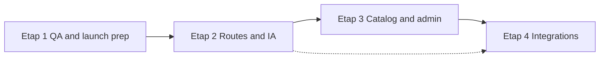

# Development roadmap

Phases align with the agreed product direction. **Completion status reflects the audit in `CURRENT_STATE.md`, not wishful “done.”**

---

## Etap 1 — Premium homepage

### Scope

- Preserve and refine the existing Warm Editorial homepage (`Hero`, editorial sections, `SignatureSequence`).
- Site chrome, metadata, tokens, and anchor navigation.
- Consultation + draft privacy as part of go-to-market readiness (already implemented; needs hardening).

### Dependencies

- Final brand naming (copy swaps via `brand.ts` and content pass).
- Asset strategy before adding video to the hero or other sections.
- Legal review for privacy and form disclosures.

### Acceptance criteria

**Engineering (2026-11-04)**

- [x] Homepage, consultation, and privacy are implemented and typecheck/lint clean.
- [x] GSAP sequence implemented with pin/scrub, reduced-motion CSS fallback, and route-leave cleanup in code (`SignatureSequence`, `SiteScrollShell`). Runtime browser verification of pin/scrub and ScrollTrigger leaks was not available in this pass.
- [ ] Homepage visually signed off on desktop, tablet, and mobile (owner).
- [ ] Core Web Vitals measured and accepted on `/` (not measured this pass; browser/Lighthouse tools unavailable).
- [ ] Consultation sends mail in staging/production with env configured (owner).
- [ ] Rate limiting suitable for chosen host (in-memory only until `O-TECH-01`).
- [ ] Privacy notice legally approved; contact/controller details published (owner).
- [ ] Production email authentication (SPF, DKIM, DMARC) for sender domain (owner).

### Out of scope (Etap 1)

- Product catalog, CMS, admin panel.
- New marketing routes beyond consultation/privacy.
- Rewriting GSAP choreography without explicit approval.

### Decisions before calling Etap 1 “launch-ready”

- Hosting provider and environment strategy.
- Analytics / cookie consent (currently none in privacy draft).
- Final languages/markets.

**Status:** *Engineering complete (2026-11-04). Launch residual is owner-owned: hosting, production Resend + DNS auth, legal privacy, visual sign-off, Core Web Vitals measurement, brand name.*

---

## Etap 2 — Future pages skeleton

### Scope

- Information architecture for **Products**, **For Architects** (beyond homepage section), **About**, and **Contact** (if distinct from consultation).
- Next.js routes, shared layouts, navigation updates, SEO metadata stubs.
- Elegant **Coming soon** or minimal placeholder pages where content is not ready—no broken nav.

### Dependencies

- Etap 1 navigation patterns and design tokens.
- Content outline per page (even placeholder).
- Decision: single-page expansion vs. dedicated routes for “Systems” lines.

### Acceptance criteria

- [x] All primary nav items resolve (pages; no coming-soon template — content was written).
- [x] Consistent header/footer; `aria-current` on path routes via `SiteNavLink`.
- [x] Homepage `#architects` retained; extra link to `/architects` only. Motion files were not edited in this milestone.
- [x] `routes` in `brand.ts` extended centrally (`about`, `architects`).

### Out of scope

- Product data model, admin, dynamic CMS.
- Full copywriting and photography production.

### Decisions before start

- URL structure (`/products` vs. `/systems/windows`, etc.).
- Whether “For architects” remains anchor-only or becomes a full page.
- Coming-soon UX pattern (inline message vs. dedicated template).

**Status:** *Complete (2026-11-04).* Category presentation pages plus `/about` and `/architects`. Contact remains `/consultation` (no separate contact route). Coming-soon template not needed. Product detail routes remain Etap 3. See `docs/PRODUCT_CATEGORIES.md` and `D-IA-02`.

**URL decision recorded:** descriptive top-level category paths (not `/products/...` and not `/systems/windows`). Header “Systems” remains `/#systems`. Header “For architects” is `/architects`. About lives in the footer.

---

## Etap 3 — Product catalog and admin

### Scope (future)

- Categories, product lists, detail pages with technical specs and media.
- Admin UI for products, images, and editorial content.
- Roles and permissions for staff.

### Dependencies

- Etap 2 IA and design patterns.
- Content model (fields, locales, attachments).
- Backend choice: headless CMS vs. custom DB + admin vs. hybrid.

### Acceptance criteria (high level)

- [ ] Authorized editors can CRUD products without deploys.
- [ ] Public catalog is static or ISR/SSR with acceptable performance.
- [ ] Media pipeline respects `ASSET_GUIDELINES` (originals vs. optimized delivery).

### Out of scope at planning stage

- Implementation of auth, database, or admin UI in this documentation phase.

### Decisions required before implementation

| Topic | Options to evaluate |
| --- | --- |
| Content source | File-based MDX, headless CMS, custom Postgres, etc. |
| Hosting | Same Next app vs. split admin |
| Auth | OAuth, magic link, IdP for staff |
| i18n | Single locale first vs. multi-market |
| Search / filters | Client vs. server, faceted taxonomy |
| Compliance | Technical datasheets, CE/market-specific docs |

**Status:** *Requirements only.*

---

## Etap 4 — Integrations

### Scope (open)

- Social publishing or content automation.
- Architect tools (downloads, spec packs, extranet—TBD).
- CRM/email marketing hooks from consultation submissions.
- Other operational integrations.

### Dependencies

- Etap 3 content model (for automated publishing).
- Vendor choices and API access.

### Acceptance criteria

- Defined per integration once prioritized.

### Out of scope

- Open-ended exploration without business owner.

**Status:** *Backlog / discovery.*

---

## Suggested sequencing

Etap 4 items that only touch consultation/CRM could start after Etap 1 if prioritized.
